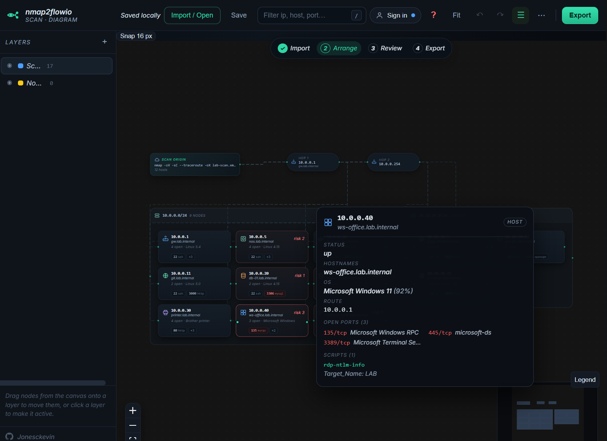

# NMAP2Flowchart

Turn an **nmap scan into an editable network diagram**. Drop in `nmap -oX` output and get a
grid-backed, zoomable canvas of subnets, hosts, open ports and traceroute hops – then reshape it:
layers, icons, notes, custom nodes and hand-drawn connections. Export to **Mermaid**, **draw.io**,
or as **print-ready SVG / PNG / PDF** for plotter-sized output.



## Quick start

**Docker (recommended):**

```bash
docker compose up -d --build     # http://localhost:8080
docker compose logs -f app
docker compose down
```

**Local development:**

```bash
cd App
npm install
npm run dev      # http://localhost:5173
npm run build    # static bundle in App/dist/
```

Click **Open sample scan** to see it working without running nmap, or **Blank canvas** to draw
something from scratch.

**Batch scan a set of subnets** with the helper scripts – they write one importable `-oX` file per
target into `scans/`:

```bash
sudo ./scripts/scan.sh                        # PREFIX=16 ARGS="-sV" OUT=out ./scripts/scan.sh
```

```powershell
.\scripts\scan.ps1                            # -Prefix 16 -NmapArgs '-sV' -OutDir out
```

Targets ending in `.0` are scanned as `<target>/<prefix>` (default `/24`); any other address is scanned
as a single host (`/32`). Default nmap flags are `-sV -O --traceroute` – root or an elevated shell
(plus Npcap on Windows) is needed for `-O`. The script keeps LF endings (see `.gitattributes`), so
keep your editor on LF for `.sh` files.

---

After pulling changes, `docker compose up -d --build` rebuilds and restarts in place. For a
hot-reloading dev server run Vite on the host instead (`cd App && npm run dev`, with `npm run api`
beside it if you want accounts) — see *Local development* above.

## Offline executables (Windows and Linux)

`npm run standalone` turns the app into **one executable per platform**: the compiled SPA is
embedded in the binary, so there is no Node.js install, no Docker, no nginx and no network access
involved. Start it and the editor opens in your browser.

> Could get flagged by Windows Smart App Control because the single-file build strips the Authenticode signature from `node.exe`. Use `npm run standalone:portable` to get a signed `node.exe` plus the same `standalone.cjs` bundle in a folder with a `start.cmd` / `start.sh` launcher. The portable folder is also the way to get

```powershell
cd App
npm ci
npm run standalone                  # release/nmap2flowchart-win-x64.exe and release/nmap2flowchart-linux-x64
npm run standalone -- --target all  # add the arm64 builds
```

From the repository root, `build-release.ps1` runs the whole release in one go — install, both
executable passes, the portable folders and the draw.io plugin package — and stops at the first
failing step:

```powershell
.\build-release.ps1                  # everything
.\build-release.ps1 -SkipInstall     # node_modules is already up to date
.\build-release.ps1 -SkipPortable    # executables only (-SkipExecutables for the reverse)
.\build-release.ps1 -SkipPlugin      # skip the draw.io plugin checks and package
```

The plugin has no compile step — draw.io loads the plain script — so the release job is to prove it
still matches the app and then package it. The build runs `node --check` on both browser files plus
[drawio-plugin/check-plugin.mjs](./drawio-plugin/check-plugin.mjs), which loads the plugin the way
draw.io does and fails if its risk tiers drift from [App/src/doc/risk.ts](./App/src/doc/risk.ts), if
the layout sizes differ from [App/src/graph/layout.ts](./App/src/graph/layout.ts), if a cell style
loses a key the app's draw.io exporter writes, or if the bundled sample scan stops parsing. It then
writes `release/nmap2drawio-plugin/` and `release/nmap2drawio-plugin.zip` (scripts, sample scan,
loader, both installers and the Compose file), and unpacks the zip again to check it.

```powershell
.\release\nmap2flowchart-portable-win-x64\start.cmd          # same flags as the .exe
```

### Using the Self contained Exe with node built in
```powershell
.\release\nmap2flowchart-win-x64.exe
```

```bash
chmod +x release/nmap2flowchart-linux-x64
./release/nmap2flowchart-linux-x64
```

| Flag | Purpose |
| --- | --- |
| `--port <n>` | Port to listen on. Default `8080`; a busy port moves to the next free one, `0` picks any. |
| `--host <addr>` | Interface to bind. Default `127.0.0.1`, so nothing is reachable from the network. |
| `--open` / `--no-open` | Force or suppress opening the browser (default: open when started from a terminal). |
| `--auth` | Enable local accounts and project autosave. |
| `--data-dir <dir>` | Where that SQLite database lives. |
| `-v`, `--version`, `-h`, `--help` | Print the build’s version or usage. |

The `NMAP_*` variables from the table below still work (`NMAP_API_PORT`, `NMAP_API_HOST`,
`NMAP_DATA_DIR`, `NMAP_AUTH_ENABLED`, …), so the executable can be run from a service manager with
the same configuration as the containers.


### Using the portable app.cjs

```powershell
cd App
npm run standalone:portable
```

`app.cjs` is the whole app — compiled SPA plus accounts API — as a 1 MB script, so on any machine that
already has **Node.js 24+** it is a one-file download:

```bash
node app.cjs        # http://127.0.0.1:8080/
```

### Downloads on the latest release

Every push to the default branch rebuilds
[`.github/workflows/release-portable.yml`](./.github/workflows/release-portable.yml) and republishes the
rolling **`portable-latest`** release with three separate downloads:

| Asset | What it is |
| --- | --- |
| `app.cjs` (+ `app.cjs.sha256`) | The whole app in one file for machines that already have Node.js 24+. Verify with `sha256sum -c app.cjs.sha256`. |
| `nmap2flowchart-portable-win-x64.zip`<br>`nmap2flowchart-portable-linux-x64.zip` | The same app with an unmodified, signed `node` runtime and a `start.cmd` / `start.sh` launcher — for machines without Node.js, including Windows Sandbox and Windows 11 with Smart App Control. |
| `nmap2drawio-plugin.zip` | The entire [draw.io plugin](./drawio-plugin): `docker compose up -d`, or `install-plugin.ps1 -Container <name>` against a draw.io you already run. |

`.\build-release.ps1` writes the same files into `release/` with the same names, so a local build can be
uploaded or handed out without renaming anything (`-SkipPlugin` / `-SkipPortable` skip either group).

## Which NMAP scans work

Any `nmap -oX` output imports, from a two-second ping sweep to a full audit. More detail simply
means more detail on the cards:

| Command | What you get on the canvas |
| --- | --- |
| `nmap -sn -oX ping.xml 10.0.0.0/24` | Live hosts only (with MAC and vendor when ARP answers). Cards read **discovered · no port scan** – nmap never looked at ports, so the app doesn't pretend they are closed. |
| `nmap -Pn -oX file.xml 10.0.0.0/24` | Hosts plus the default top-1000 port table. Service *names* come from nmap's table, so cards show `22/ssh` – no versions or scripts. |
| `nmap -sS -oX file.xml 10.0.0.0/24` | The same as `-Pn`, driven by SYN replies instead of ping. Needs root; without it use `-sT`, which produces the same XML. |
| `nmap -sV -sC --traceroute -oX full.xml …` | Everything: service versions, NSE script output, OS guesses and a traceroute lane. |
