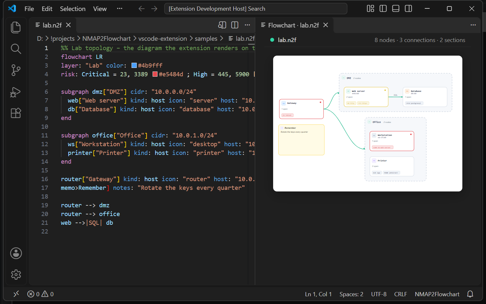
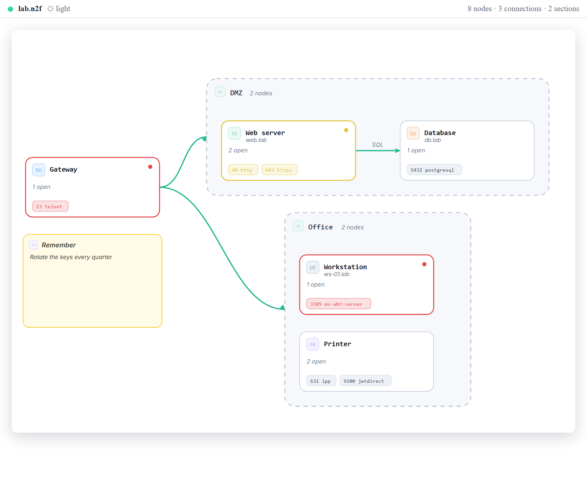
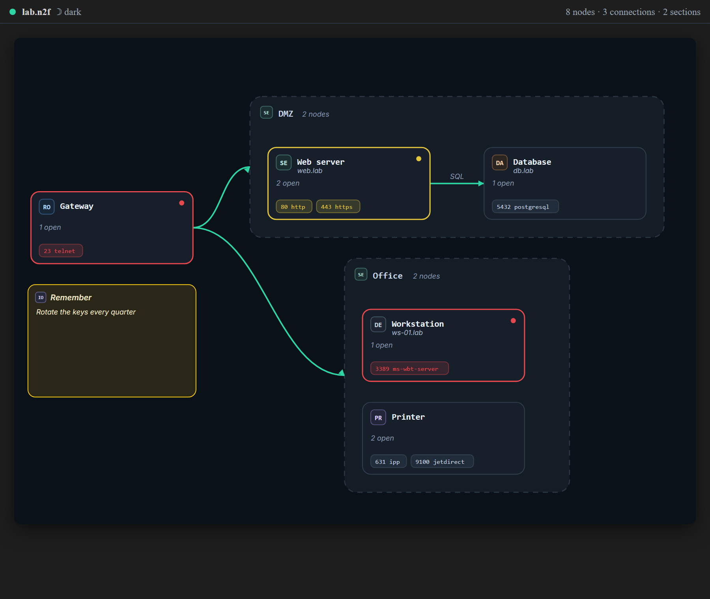
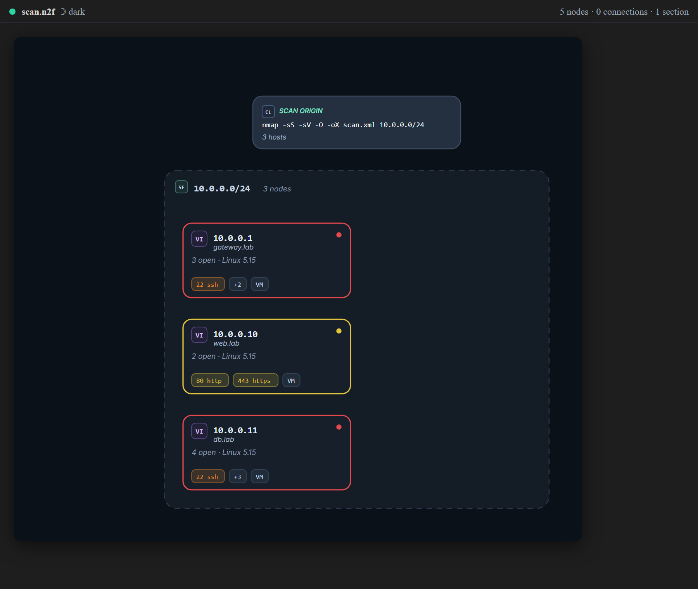

# NMAP2Flowchart for VS Code

Syntax highlighting and a live flowchart preview for **NMAP2Flowchart** diagrams – network maps you write as code.



Open a `.n2f` file and the diagram is drawn beside it with the preview button in the editor title bar
(or **NMAP2Flowchart: Open Flowchart Preview**). It redraws as you type.

The picture follows your editor's colour theme, and the ☀/☾ title-bar button flips it:

| Light | Dark |
| --- | --- |
|  |  |

## What it does

- **Import nmap scans** – the ☁ button on a diagram's title bar (and on an open scan), or
  **NMAP2Flowchart: Import Nmap Scan (XML)…** in the command palette, or right-click any `.xml` in the
  Explorer. `nmap -oX` output becomes editable diagram code and the picture opens beside it;
  [samples/scan.xml](./samples/scan.xml) is a small scan to try it on.
- **Syntax highlighting** – directives, attribute names, strings, numbers, connection arrows, edge
  labels and colours.
- **Live preview** – 250 ms after you stop typing, following whichever diagram is active.
- **Light or dark** – `auto` follows the editor, or force either palette.
- **Errors with a line number**, and the last diagram that parsed stays on screen (dimmed) while you
  fix a typo.
- **Multi-line cards** – an indented `key: value` line continues the statement above it.
- **Snippets** – `header`, `host`, `section`, `note`, `edge`, `route`, `risk`.
- **Export SVG** – the same picture in the light palette, ready for a wiki, a ticket or a print.

## From a scan to a diagram

Run `nmap -sS -sV -O -oX scan.xml 10.0.0.0/24`, then **NMAP2Flowchart: Import Nmap Scan (XML)…** and
pick the file. [samples/scan.xml](./samples/scan.xml) arrives as:



Addresses, hostnames, MAC vendors, OS guesses and port states all come across, and the built-in risk
levels colour the ports exactly as they do in the web app. The text is the diagram, so rename a card,
move it to another section or add a connection and the picture follows.

## The format

```yaml
%% a comment
flowchart LR
layer: "Lab" color: #4b9fff
risk: Critical = 23, 3389 #e5484d ; High = 445 #f08c2e

subgraph dmz["DMZ"] cidr: "10.0.0.0/24"
  web["Web server"] kind: host host: "10.0.0.10" ports: "80/http, 443/https"
  db["Database"] kind: host host: "10.0.0.11" ports: "5432/postgresql"
end
web -->|SQL| db
```

A card with a lot of detail reads better spread over indented lines:

```yaml
web["Web servers"] kind: host
  icon: "server"
  host: "10.0.0.10" hostname: "web.lab"
  ports: "80/http, 443/https"
```

`#` or `%%` starts a comment. Open [samples/lab.n2f](./samples/lab.n2f) for a complete example, or
import [samples/scan.xml](./samples/scan.xml) to get one generated from a scan.

## Commands and settings

| | |
| --- | --- |
| **NMAP2Flowchart: Open Flowchart Preview** | the editor-title button; opens beside the editor |
| **NMAP2Flowchart: Import Nmap Scan (XML)…** | the ☁ title-bar button; `nmap -oX` output in, an editable `.n2f` document out |
| **NMAP2Flowchart: Toggle Dark Preview** | the ☀/☾ title-bar button; flips the palette and remembers it |
| **NMAP2Flowchart: Export Diagram as SVG…** | save the picture as an SVG file (always the light palette) |
| `n2f.preview.autoOpen` | open the preview whenever a diagram becomes the active editor (default off) |
| `n2f.preview.theme` | `auto` (follow the editor), `light` or `dark`; the toggle writes this |

## Install

Search **NMAP2Flowchart** in the Extensions view, or:

```powershell
code --install-extension jonesckevin.nmap2flowchart
```

A `.vsix` needs no Marketplace account: every push to the default branch attaches one to the
[`vscode-latest` release](https://github.com/Jonesckevin/NMAP2Flowchart/releases/tag/vscode-latest).
Download `nmap2flowchart.vsix` from there, then

```powershell
code --install-extension nmap2flowchart.vsix
```

or use **Extensions → ⋯ → Install from VSIX…** in VS Code.

## Development

```powershell
cd vscode-extension
npm ci
npm run sync      # copy the parser, layout, renderer and scan reader from ../App/src
npm run verify    # sync:check + typecheck + bundle + tests
npm run package   # nmap2flowchart-<version>.vsix
```

Press <kbd>F5</kbd> in this folder to run it in an Extension Development Host. `src/core/app` is
generated – edit `App/src` and run `npm run sync`; `sync:check` fails when the copy has drifted.

The extension compiles the same parser, layout and SVG writer as the
[NMAP2Flowchart web app](https://github.com/Jonesckevin/NMAP2Flowchart), so the preview always matches
what the app exports.

## Releasing

[`.github/workflows/vscode-extension.yml`](../.github/workflows/vscode-extension.yml) verifies, packages
and republishes `nmap2flowchart.vsix` (+ `.sha256`) on the rolling `vscode-latest` release on every push
to the default branch – nothing else to run. For a versioned release, bump `version` here, commit, then
tag:

```powershell
git tag vscode-v0.1.1
git push origin vscode-v0.1.1
```

The tag must match `package.json`, or the workflow refuses it. Publishing to the Visual Studio
Marketplace is opt-in (`PUBLISH_MARKETPLACE` repository variable, Trusted Publishing – no token).

Licence: [MIT](./LICENSE).
